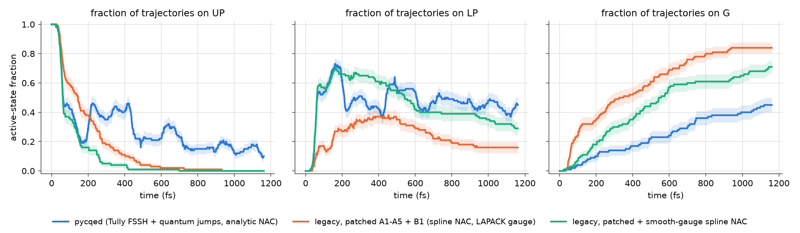
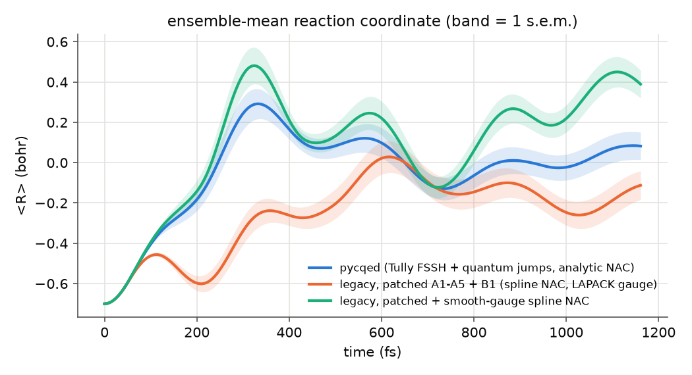
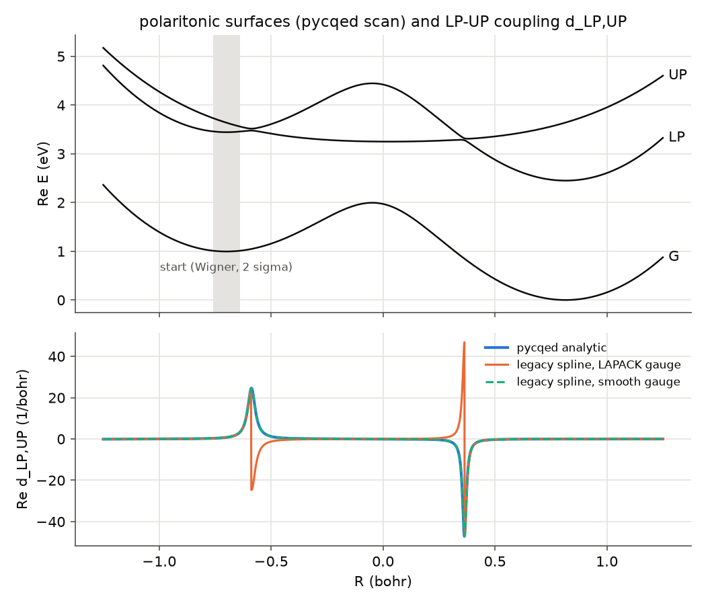

# Trajectory-level comparison: `pycqed` vs. patched legacy PFSSH

**Verdict.** The new engine reproduces the legacy physics wherever the two algorithms are meant to agree:

- The nuclear integrator and forces match. On matched initial conditions, R agrees to ≤ 3e-5 bohr until the first stochastic event in either code.
- The polaritonic surfaces match to ≤ 1.3e-6 Ha, a residual that comes from the legacy 27.211 eV/Ha conversion.
- With a gauge-smooth legacy NAC, electronic propagation through an LP/UP crossing agrees to 4 decimals.
- The ensembles agree within 2σ for the first ~150 fs, i.e. through the first crossing.

After that the ensembles diverge, and each divergence traces to an intended algorithmic difference or to a legacy defect (below). **No bug was found in `pycqed/`**, which this branch does not modify.

## Set-up

| | |
|---|---|
| Scenario | double well (`DoubleWellModel` = legacy `ARCHIVE/polaritonic.py:E_of_R`), Rabi coupling, `n_fock = 1`, ω = 2.45 eV, g = 0.02 eV, γ = 1 meV, start on UP |
| Nuclei | M = 1009883, dt = 0.12 au, BBK friction 1.2e-5 au, T = 0 |
| Ensemble | 100 trajectories, 400 000 steps each (48 000 au = 1.16 ps), sampled every 500 steps |
| Initial conditions | Wigner samples from `pycqed` (`examples/legacy_double_well.toml`, seed 1). The *same* (R, P) list (`ics.txt`) is fed to both codes. |
| New code | `examples/legacy_double_well.toml` with `n_steps = 400000` and `n_traj = 100`. `run_new.py` uses the CLI's per-trajectory RNG streams, run in parallel. |
| Legacy code | scratch copies of `ARCHIVE/polaritonic.py` and `ARCHIVE/PFSSH.py` with `legacy_fixes.patch` applied (`run_legacy.py`; the patch paths are relative to the copy directory). The repository originals are untouched. |

### Legacy fixes applied to the copy (`legacy_fixes.patch`)

- **A1** `Write_PES` writes complex energies, so the imaginary (decay) splines are no longer zero.
- **A2** `elif` in the UP→G / UP→LP hop decision.
- **A3** Energy-conserving 1-D rescale P′ = sign(P)·√(P² − 2MΔE). A frustrated hop is cancelled and P is left unchanged. Hops into G (the photon-loss sink) are not rescaled, matching quantum jumps in `pycqed`.
- **A4** The random force is no longer multiplied by 0, but runs use T = 0.
- **A5** `C_polariton` and the populations are reset for every repeat.
- **B1 (found here)** The BBK second half-step subtracted γ·v₁/₂ from `a_fut` *and* divided by (1 + γdt/2), so the effective friction was about 1.5γ. The γ·v₁/₂ term was removed.
- Harness additions only: read (R, P) from a file, record R/V/active/populations every 500 steps, count hops, and an optional `LEGACY_SMOOTH_GAUGE=1` (see below).

Another legacy defect is noted but bypassed by the matched initial conditions: `Initialize_Phase_Space` uses σ_P = √(a − √π·a^½/2) = 23.3 instead of the harmonic ground-state √(a/2) = 16.8.

## Results





Three ensembles are shown:

- **blue:** `pycqed` (Tully fewest switches, quantum jumps, analytic chain-rule NAC)
- **orange:** legacy with the fixes above
- **green:** the same legacy code with the spline NAC rebuilt in a smooth (parallel-transport) gauge

### Active-state fractions

| t (fs) | pycqed G / LP / UP | legacy G / LP / UP | legacy smooth-gauge G / LP / UP |
|---|---|---|---|
| 100 | 0.04 / 0.54 / 0.42 | 0.24 / 0.17 / 0.59 | 0.07 / 0.57 / 0.36 |
| 250 | 0.13 / 0.46 / 0.41 | 0.40 / 0.32 / 0.28 | 0.24 / 0.65 / 0.11 |
| 501 | 0.22 / 0.57 / 0.21 | 0.61 / 0.35 / 0.04 | 0.46 / 0.53 / 0.01 |
| 1161 | 0.45 / 0.45 / 0.10 | 0.84 / 0.16 / 0.00 | 0.71 / 0.29 / 0.00 |

### Mean R (bohr)

| t (fs) | pycqed | legacy | legacy smooth-gauge |
|---|---|---|---|
| 100 | −0.404 | −0.462 | −0.395 |
| 250 | 0.020 | −0.532 | 0.123 |
| 1161 | 0.082 | −0.113 | 0.389 |

The statistical error of a fraction is ≤ 0.05 (1σ).

### Hop counts (100 trajectories)

| event | pycqed | legacy | legacy smooth-gauge |
|---|---|---|---|
| UP→LP hop | 214 | 80 | 91 |
| LP→UP hop | 136 (in 79 trajectories) | not allowed | not allowed |
| frustrated LP→UP | 35 | – | – |
| → G (pycqed: quantum jump; legacy: sink hop) | 45 (33 from LP, 12 from UP) | 84 (64 from LP, 20 from UP) | 71 (62 from LP, 9 from UP) |

Agreement window: up to 150 fs, pycqed and the smooth-gauge legacy run differ by ≤ 0.09 in every fraction (max z = 1.7) and by ≤ 0.03 bohr in ⟨R⟩. The as-patched legacy run already differs by 0.4 in the LP fraction at 100 fs (z = 6.6).

All numbers are in `summary.json`. Per-trajectory R, active state and events are in `ensemble.npz`.

## Where the differences come from

### 1. Legacy spline NAC (dominant before ~200 fs; a legacy defect, not just a different method)



`Write_PES` finite-differences `numpy.linalg.eig` eigenvectors, and LAPACK fixes each eigenvector's phase by making its largest component real. At each LP/UP avoided crossing (R = −0.588 and 0.365) the largest component switches between |g,1⟩ and |e,0⟩, so one eigenvector flips sign. As a result, d_LP,UP changes sign at the crossing instead of forming a single Lorentzian:

| | integral of d_LP,UP over R ∈ [−0.8, −0.4] | integral over R ∈ [0.2, 0.6] |
|---|---|---|
| pycqed analytic | 1.463 | −1.513 |
| legacy spline (LAPACK gauge) | −0.076 | −0.025 |
| legacy spline (smooth gauge) | 1.462 | −1.513 |

Each integral should be ≈ ±π/2 (the mixing-angle change), minus the cut-off tails. The flip point also breaks the antisymmetry of d: |d₂₃ + d₃₂| reaches 96 there, so the legacy RK4 is not norm-conserving across the crossing.

`single_passage.py` isolates this. It propagates the electronic amplitudes only, at fixed velocity, through the R = −0.588 crossing, starting on UP:

| v (au) | Landau–Zener P(→LP) | legacy LAPACK gauge LP / norm | legacy smooth gauge LP / norm | pycqed LP / norm |
|---|---|---|---|---|
| 3e-5 | 0.209 | 0.244 / 0.916 | 0.223 / 0.937 | 0.224 / 0.937 |
| 6e-5 | 0.458 | 0.251 / 0.933 | 0.440 / 0.979 | 0.440 / 0.978 |
| 9e-5 | 0.594 | 0.187 / 0.933 | 0.626 / 0.990 | 0.626 / 0.990 |

`pycqed` and the smooth-gauge legacy propagator agree to 4 decimals and follow Landau–Zener. With the LAPACK gauge, the transfer is stuck near 0.2 whatever the velocity, and up to 6% of the norm is lost spuriously. The legacy sink turns that lost norm into G hops: in the first 100 fs, 24 G hops occur with the LAPACK gauge against 7 with the smooth gauge, and 33 of 84 sink hops sit within 0.03 bohr of a crossing against 10 of 71. This explains both the orange early G rise and the orange trajectories that stay on adiabatic UP, which is photonic and uphill past the crossing, and turn back: ⟨R⟩ stalls at −0.46 around 110 fs and falls back to −0.60 at 210 fs.

**Switching only the NAC gauge** (orange → green) moves the legacy ensemble onto `pycqed` for the first ~150 fs. The remaining differences come from items 2 and 3.

### 2. Population-derivative hop rule vs. Tully fewest switches (dominant UP/LP difference after ~200 fs)

The legacy rule evaluates g_k = max(0, ṗ_k)·dt / p_active **only for k below the active index** (UP→LP, UP→G, LP→G). For a two-state exchange its downward probability equals Tully's flux expression, but it can never hop *up*. In `pycqed`:

- 79 of 100 trajectories make at least one LP→UP hop (136 in total, plus 35 frustrated attempts).
- 126 of the 136 happen within 0.05 bohr of a crossing, as LP-borne trajectories re-cross R ≈ −0.59 or 0.37.
- This is what holds pycqed's UP fraction at 0.1–0.45 after 200 fs (the 200–450 fs plateau and the later bumps).
- It also explains the larger gross UP→LP count, 214 against 91. The *net* UP→LP counts are similar: 214 − 136 = 78 against 91.

In the legacy run, by contrast, UP empties monotonically, and every legacy LP trajectory stays on the excitonic surface. That pushes the smooth-gauge ⟨R⟩ further into the right-hand well (0.39 against 0.08 at 1.16 ps).

### 3. Ground-state sink vs. quantum jumps (G-fraction difference throughout)

Both codes take the decay probability from the total norm lost in the step, Δ = −dN, and in both the destination is effectively G. They differ in the normalisation:

| | probability per step |
|---|---|
| legacy | Δ / p_active, with p unnormalised. G is defined as 1 − trace and the wavefunction is never renormalised or collapsed. |
| pycqed | Δ / N, after which ψ ← bψ (renormalised), so the jump collapses the wavefunction. |

The ratio between them is N / p_active = 1 / (normalised population of the active state). Over the legacy runs this ratio has a median of 1.3–1.6 and a mean of 2.3–3.6, and it is largest exactly when a trajectory sits on excitonic LP while most of its amplitude is on photonic UP. Hence 71 sink hops in the smooth-gauge legacy run against 45 quantum jumps, and a final G fraction of 0.71 against 0.45 (0.84 with the LAPACK-gauge NAC, which adds the spurious norm loss of item 1). In the legacy code a trajectory that has reached G also keeps its un-collapsed LP/UP amplitudes, but because the rule is downward-only, G is absorbing in both codes.

### Minor

- Energies differ by ≤ 1.3e-6 Ha because the legacy code uses 27.211 instead of CODATA 27.211386 eV/Ha.
- The legacy force is the derivative of a cubic spline on a 2000-point grid. pycqed uses the analytic Re ∇E.
- Together these explain the ≤ 3e-5 bohr pre-event difference in R.
- The legacy RK4 uses a single step of dt = 0.12 au. pycqed uses 5 `expm` substeps. The single-passage table shows that this is immaterial here.

## Reproduce

```bash
W=$PWD; S=$(mktemp -d); mkdir -p $S/legacy/Data && cp ARCHIVE/polaritonic.py ARCHIVE/PFSSH.py $S/legacy/
(cd $S/legacy && patch -p1 < "$W/analysis/legacy_comparison/legacy_fixes.patch")
python analysis/legacy_comparison/run_new.py --n-traj 100 --n-steps 400000 --workers 10 --out $S/runs
python analysis/legacy_comparison/run_legacy.py --legacy-dir $S/legacy --ics $S/runs/ics.txt --n-steps 400000 --out $S/runs
python analysis/legacy_comparison/run_legacy.py --legacy-dir $S/legacy --ics $S/runs/ics.txt --n-steps 400000 --out $S/runs --smooth-gauge
python analysis/legacy_comparison/compare.py $S/runs $S/legacy
python analysis/legacy_comparison/single_passage.py $S/legacy
```

Wall time on 14 cores: about 30 min for `pycqed` (≈ 175 s per trajectory) and about 25 min per legacy variant on 2 processes each.
